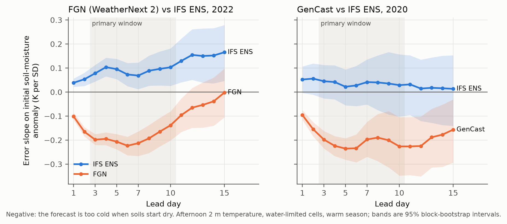
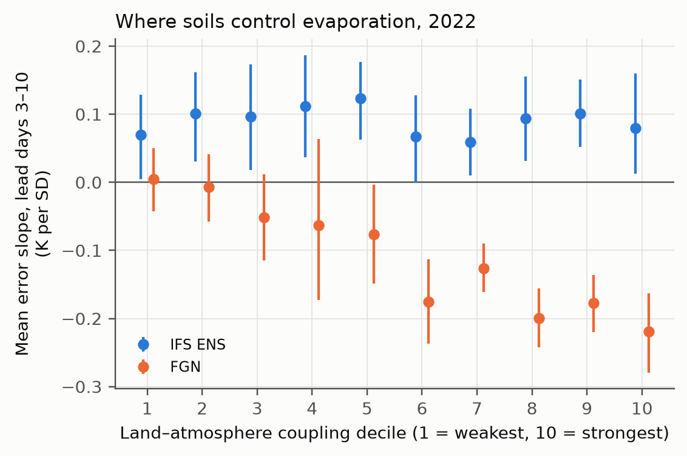
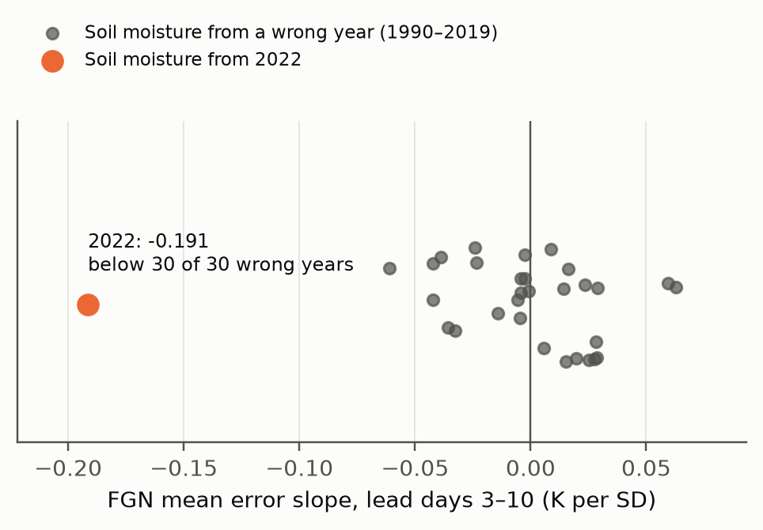

<h1 align="center">land-blind</h1>

<p align="center">
  <b>AI weather ensembles miss the soil moisture they never see</b><br>
  A pre-registered test of GenCast and WeatherNext 2 against the physics-based IFS ensemble
</p>

<p align="center">
  <a href="https://github.com/rohanbalixz/land-blind/actions/workflows/ci.yml"></a>
  <a href="docs/preregistration.md"></a>
  <a href="https://www.python.org"></a>
  <a href="LICENSE"></a>
  <a href="https://weatherbench2.readthedocs.io"></a>
</p>

---

AI weather models now beat physics-based forecasts on most scores, yet their inputs contain no land
surface: no soil moisture, soil temperature, snow or vegetation. A forecast that uses everything
known at issue time has errors that nothing known at issue time can predict. This repository asks
whether the errors of two leading AI ensembles, **FGN** (the model behind WeatherNext 2) and
**GenCast**, can be predicted from the one thing they cannot see: the soil-moisture state at
initialisation.

**They can.** Over water-limited land in the warm season, a root zone one standard deviation drier
than normal makes afternoon 2 m temperature forecasts at lead days 3–10 too cold by **0.19 K for
FGN** (2022) and **0.21 K for GenCast** (2020). The IFS ensemble, which carries a land-surface model,
shows no such bias; its errors move slightly the other way. The effect sits where, and when, land
controls heat. It vanishes when soil moisture from the wrong year is used, and circulation errors do
not explain it. All four confirmatory tests were registered before any data were read, and all four
are supported.

<p align="center">
  
</p>

## Results

| Registered test (Holm-adjusted, one-sided α = 0.05) | Estimate, K per SD | 95% CI | Verdict |
|---|---|---|---|
| **H1** FGN 2022 errors depend on initial soil moisture | −0.191 | [−0.229, −0.157] | supported |
| **H2** … more than IFS ENS errors do | −0.280 | [−0.320, −0.238] | supported |
| **H3** GenCast 2020 errors depend on initial soil moisture | −0.213 | [−0.274, −0.150] | supported |
| **H4** … more than IFS ENS errors do | −0.248 | [−0.302, −0.198] | supported |

Estimates are the slope of the ensemble-mean afternoon 2 m temperature error on the standardised
root-zone soil-moisture anomaly the day before initialisation, averaged over lead days 3–10. A
negative value means the forecast is too cold when soils start dry. All four Holm-adjusted p-values
are below 0.001. Every test can detect 0.05–0.08 K per SD with 80% power, smaller than the
registered smallest effect of interest (0.10 K per SD). The full output, including all secondary and
robustness analyses, is in [`results/summary.md`](results/summary.md).

### The effect behaves like land memory

<table>
  <tr>
    <td width="50%"></td>
    <td width="50%"></td>
  </tr>
  <tr>
    <td>FGN's slope steepens with coupling strength: from 0.00 in the least-coupled decile to −0.22 in the most-coupled. IFS ENS stays flat.</td>
    <td>Soil moisture from each of 30 wrong years gives slopes between −0.06 and +0.06. The true 2022 slope, −0.19, is below all 30.</td>
  </tr>
</table>

All of the following were predicted in the pre-registration:

- **Where soils control evaporation.** The FGN slope is −0.19 in water-limited cells and −0.01 in
  energy-limited cells ([map of the regimes](results/figures/fig4_coupling_map.png)).
- **In the afternoon.** The FGN − IFS gap is −0.28 K per SD in the afternoon and −0.17 at night
  (difference −0.12, 95% CI −0.14 to −0.09). Surface fluxes act in daytime.
- **Building after initialisation.** The gap is larger at lead days 7–10 than at days 1–2, by 0.09 K
  for FGN and 0.06 K for GenCast.
- **Not a circulation error.** Controlling for the day-5 500 hPa forecast error leaves 92% of the
  slope (95% CI 87–99%).
- **Robust.** The slope holds when the verifying analysis is swapped (FGN against ERA5: −0.21;
  GenCast against HRES-t0: −0.20). It holds when each continent is dropped in turn (−0.17 to −0.21
  for FGN), with 14-day bootstrap blocks, and with Driscoll–Kraay standard errors, which match the
  bootstrap's (0.019 each).

**Hot afternoons.** Over dry soils FGN gives a hot afternoon (above the local 90th percentile) a
9.5% chance at lead day 5; such afternoons happen 12.5% of the time. Over wet soils the figures are
4.2% and 3.6%, so FGN's hot-day probabilities respond too little to the land
([figure](results/figures/fig5_hot_day_probability.png)). IFS ENS over-forecasts hot afternoons in
both strata (20.5% and 8.9%), so its higher dry-soil probability is not better calibration.

### What does not fit cleanly

- **No CRPS penalty.** The registered prediction that FGN's CRPS advantage over IFS ENS shrinks over
  dry soils (S8) is **not supported**: the advantage is the same over dry and wet soils.
- **Within-month changes.** When the slope is identified only from within-month changes in soil
  moisture (cell × calendar-month fixed effects), the AI-only slope halves. It is −0.09
  [−0.14, −0.04] for FGN and −0.06 [−0.13, +0.02] for GenCast. The AI − IFS gap widens to about
  −0.35, because IFS ENS has its own, opposite error on short-lived wetting and drying (+0.25 to
  +0.30). The AI cold bias over dry soils is clearest for persistent, season-scale anomalies.
- **Exploratory decomposition (not pre-registered).** In 2022, observed afternoon temperature falls
  by 0.20 K per SD of wetter soil, IFS ENS forecasts fall by 0.29 K, and FGN forecasts by 0.01 K:
  FGN's forecasts essentially ignore the land. In 2020 the observed slope is near zero, IFS ENS
  matches it, and GenCast moves the wrong way (+0.25). These level slopes are observational and can
  be confounded by weather. The registered error-slope tests do not need a causal reading, because an
  efficient forecast's errors are unpredictable from any issue-time information.

## Design

| | |
|---|---|
| **Systems** | FGN (64 members, 2022) and GenCast (56 members, 2020) against IFS ENS (50 members, same years); WeatherBench 2, 1.5° grid, 00 UTC initialisations |
| **Outcome** | Ensemble-mean error of 2 m temperature at ≈15:00 local solar time, lead days 1–15, in each cell's three warmest months |
| **Covariate** | ERA5 root-zone (0–100 cm) soil-moisture anomaly on the day before initialisation, standardised by its 1990–2019 day-of-year climatology |
| **Population** | Water-limited cells: the top tercile of the terrestrial coupling index (Dirmeyer, 2011), computed from ERA5 1990–2019 fluxes before any forecast was opened |
| **Estimand** | Fixed-effects slope (cell and date), controlling for the previous day's maximum-temperature anomaly and the initial-time temperature anomaly, both of which the AI models do see |
| **Contrast** | AI − IFS. The verifying analysis cancels out, so the contrast does not depend on the choice of truth |
| **Truth** | Each AI model is verified against the analysis it was trained to predict: HRES-t0 for FGN, ERA5 for GenCast. The other analysis is a registered robustness check |
| **Inference** | 7-day moving-block bootstrap over dates, resampling whole maps (B = 2000); Driscoll–Kraay errors as a cross-check; Holm across the four tests; equivalence bounds of ±0.10 K per SD, so a null would have been informative |
| **Controls** | Wrong-year soil moisture (30 placebos); 500 hPa error; energy-limited cells; night-time targets; injected synthetic effects recovered to 4 × 10⁻⁹ |

The plan, with every threshold and the reading of each possible outcome fixed in advance, is in
[`docs/preregistration.md`](docs/preregistration.md). It was committed as
[`00f4f2c`](https://github.com/rohanbalixz/land-blind/commit/00f4f2c1e79d21c40b7afcf6c40edb4d40a755bb)
before any forecast, analysis or reanalysis value was read, and is tagged `preregistration`. Every
later change is dated in [`docs/deviations.md`](docs/deviations.md), including one clarification
made before any data were read and the exploratory additions made after the results were seen.

## Reproduce

```bash
git clone https://github.com/rohanbalixz/land-blind.git && cd land-blind
conda env create -f environment.yml && conda activate landblind
make test    # 35 tests, including a synthetic end-to-end run with a planted effect
make all     # download (~30 GB), covariates, panels, member scores, tests, figures
```

`make fetch` mirrors only the chunks the analysis needs from the public WeatherBench 2 bucket. It
checks each chunk against the MD5 that Cloud Storage reports and resumes if interrupted.
`results.json` records a SHA-256 digest of every mirrored store, so a rerun can confirm that it read
byte-identical inputs. On a laptop the analysis takes about three minutes once the data are local.

| Step | Command | Output |
|---|---|---|
| Download | `python -m landblind fetch metadata era5 forecasts truth members` | `data/mirror/` |
| Covariates (ERA5 only) | `python -m landblind covariates` | `data/processed/covariates.nc` |
| Panels | `python -m landblind extract` | `data/processed/panel_*.nc` |
| Member scores | `python -m landblind members` | `data/processed/members_fgn2022.nc` |
| Registered tests | `python -m landblind analyze` | `results/results.json`, `results/summary.md`, `results/tables/` |
| Figures | `python -m landblind figures` | `results/figures/` |

## Repository layout

```
config/analysis.yaml        every registered parameter
docs/preregistration.md     hypotheses, estimands and decision rules (the first commit)
docs/deviations.md          dated log of every change to the plan
docs/data.md                data sources, model inputs and licences
src/landblind/
  mirror.py                 partial, checksum-verified, resumable mirror of public Zarr stores
  fetch.py                  the registered data selection
  covariates.py             ERA5 only: domain, soil-moisture anomalies, coupling, warm season
  panels.py                 afternoon and night forecast/truth arrays for each model pair
  members.py, scores.py     fair CRPS, spread and hot-day probabilities from ensemble members
  stats.py                  fixed-effects slopes, block bootstrap, Driscoll–Kraay, Holm, TOST
  analysis.py, report.py    the registered tests and the generated summary
  figures.py
tests/                      unit tests and the synthetic end-to-end test
results/                    outputs, committed with the code commit that produced them
```

## Limitations

- The truth is gridded analysis at 1.5°, not station data.
- ERA5 soil moisture comes from the same family of land model as IFS ENS, which could favour IFS ENS
  in the AI − IFS contrast. The AI-only tests (H1, H3) are not affected.
- Each AI model is evaluated in one year. Spatial pooling and the block bootstrap address precision,
  but not year-specific weather.
- 2022 was the validation year in the FGN paper. If it is inside the training data used for these
  forecasts, memorisation can only shrink FGN's errors, which makes H1 conservative.
- GenCast steps every 12 hours, so its afternoon sample is limited to longitudes where 00 or 12 UTC
  falls within three hours of 15:00 local time.

## Citation

```bibtex
@software{bali2026landblind,
  author  = {Bali, Rohan},
  title   = {land-blind: {AI} weather ensembles miss the soil moisture they never see},
  year    = {2026},
  version = {1.0.0},
  url     = {https://github.com/rohanbalixz/land-blind}
}
```

## Acknowledgements and references

Data come from [WeatherBench 2](https://weatherbench2.readthedocs.io) (Rasp et al., 2024): ERA5
(Hersbach et al., 2020) from the Copernicus Climate Change Service; IFS ENS forecasts and HRES
analyses from ECMWF; and GenCast and FGN forecasts from Google DeepMind. Licences are listed in
[`docs/data.md`](docs/data.md).

- Alet, F. et al. (2025). Skillful joint probabilistic weather forecasting from marginals. arXiv:2506.10772.
- Dirmeyer, P. A. (2011). The terrestrial segment of soil moisture–climate coupling. *GRL*, 38, L16702.
- Driscoll, J. C. and Kraay, A. C. (1998). Consistent covariance matrix estimation with spatially dependent panel data. *Rev. Econ. Stat.*, 80, 549–560.
- Ferro, C. A. T. (2014). Fair scores for ensemble forecasts. *QJRMS*, 140, 1917–1923.
- Hersbach, H. et al. (2020). The ERA5 global reanalysis. *QJRMS*, 146, 1999–2049.
- Price, I. et al. (2025). Probabilistic weather forecasting with machine learning. *Nature*, 637, 84–90.
- Rasp, S. et al. (2024). WeatherBench 2: A benchmark for the next generation of data-driven global weather models. *JAMES*, 16, e2023MS004019.
- Seneviratne, S. I. et al. (2010). Investigating soil moisture–climate interactions in a changing climate: A review. *Earth-Sci. Rev.*, 99, 125–161.

## Licence

Code: [MIT](LICENSE). Data: see [`docs/data.md`](docs/data.md).
